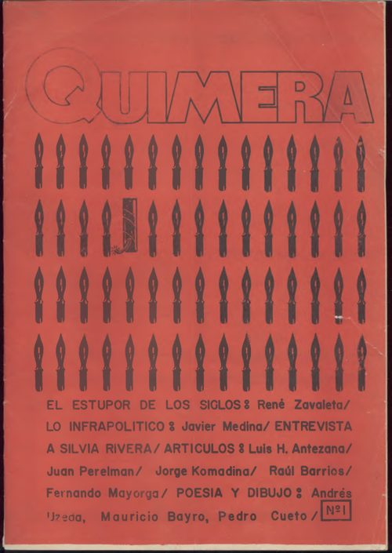
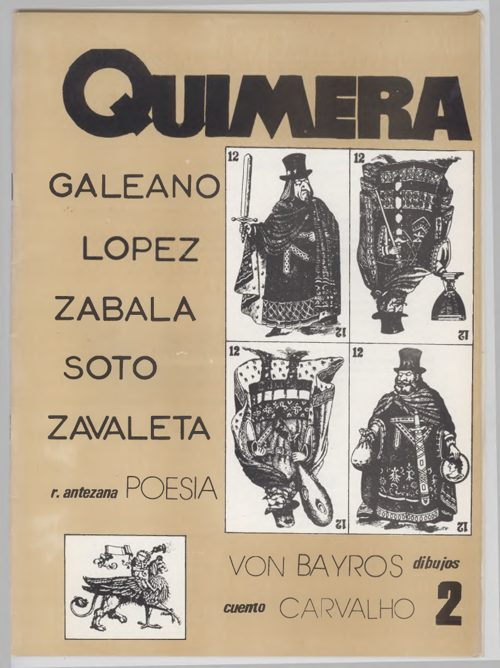
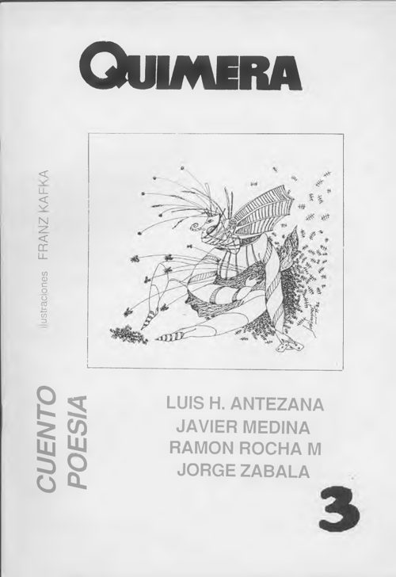

<section class="proyecto">

<h2 class="proyecto__titulo">Blog Artimaña 2011–2018</h2>

«La suerte es cara o cruz, la política es arte y maña.»

Blog personal: <a href="https://pioresnada.wordpress.com">pioresnada.wordpress.com</a>

</section>

<section class="proyecto">

<h2 class="proyecto__titulo">Revista Quimera 1985–1987</h2>

  <a class="zine" href="/files/quimera/quimera%201.pdf">
    
    Nº 1
    Septiembre de 1985
    René Zavaleta, Luis H. Antezana, Javier Medina, Jorge Komadina; entrevista a Silvia Rivera.
  </a>

  <a class="zine" href="/files/quimera/quimera%202.pdf">
    
    Nº 2
    Enero de 1986
    René Zavaleta, Eduardo Galeano, Gustavo Soto, Jorge Zabala, Eduardo López, Homero Carvalho.
  </a>

  <a class="zine" href="/files/quimera/quimera%203.pdf">
    
    Nº 3
    Septiembre de 1987
    Luis H. Antezana, Javier Medina, Ramón Rocha Monroy, Jorge Zabala; ilustraciones de Franz Kafka.
  </a>

Haz clic en una portada para leer el número completo (PDF).

Esta revista nació en un café que congregaba a una pequeña caterva de nacionalistas, izquierdistas y anarquistas. Las pláticas con Yoyo Komadina y Jorge Zabala, entre otros amigos, fueron un impulso para esa ocurrencia. En 1984 había retornado de México y me enrolé como docente en la universidad pública. Ese año conocí a Filemón Escóbar en la presentación de su libro <em>Testimonio de un militante obrero</em> y nuestra amistad se extendió durante décadas, pese a nuestras divergencias tácticas. Por eso, la primera tapa de <em>Quimera</em> combina, en rojo y negro, un cachorro de dinamita en medio de pluma fuentes. Mi revista fue inédita en varios sentidos: incluyó un fragmento de <em>Lo nacional popular en Bolivia</em> -todavía inédito- de René Zavaleta Mercado y el primer ensayo de Cachín Antezana sobre el pensador orureño. Y tenía varias secciones matizadas con cierto humor negro. Por su tono irónico fue mal recibida -para alegría nuestra- por los militantes de izquierda y de derecha. Corría el año 1985.

Le entregué un ejemplar a Eduardo Galeano -estaba de visita en Cochabamba- y conversé con él gracias a la generosidad de Alfredo Medrano. Se emocionó mucho cuando leyó un fragmento del texto de René Zavaleta Mercado, puesto que fueron amigos íntimos desde fines de los años 60 cuando trabajaban en el célebre semanario <em>Marcha</em> en Montevideo. También le regalé un texto de Federico Aguiló sobre Santa Vera Cruz Tatala, algo de Franz Tamayo y otros textos que no recuerdo, con la esperanza de que los utilice en su memorable trilogía <em>Memoria del fuego</em>. Tres meses después llegó un sobre manila por correo desde Uruguay y cuando lo abrí no podía creer: ¡me había mandado 10 textos inéditos! Los publiqué en el segundo número de <em>Quimera</em>, en 1986, y después formaron parte del tercer volumen de su <em>Memoria del fuego</em>. Entre esos textos geniales que reescriben la historia se destacan los dedicados a Pancho Villa, Isadora Duncan y Obdulio Varela, el caudillo de la selección uruguaya campeona mundial en Brasil 1950. Así es, Eduardo Galeano envió textos originales para colaborar en una marginal revista boliviana. Un verdadero honor, y lo hizo voluntariamente, quizás para alentar una relación de complicidades que cuento en otros textos.

En septiembre de 1987 salió el tercer y último número de <em>Quimera</em>. Aunque se menciona a un equipo de “responsables” -y el respaldo de Hisbol- encaré esa labor prácticamente en solitario. Empero ese esfuerzo se convertía en goce colectivo en sus presentaciones públicas en el <em>18 Brumario</em>, una chichería itinerante, al ritmo de las zampoñas del grupo Pusisuyu y el canto de Gilberto Lisperguer y Chela Rivera, con hojas de coca y wiphalas cuando eran casi clandestinas. Incluyó un cancionero de bailecitos y <em>Un pajarillo llamado Mané</em> de Cachín Antezana, que se convirtió en el legendario ensayo. También textos de Jorge Zabala y Ramón Rocha Monroy, siempre originales, un poema de Luis <em>Pajarito</em> Mérida y reproduje los grafitis que trazaba mi hermano Coco en las paredes de Cochabamba antes que nadie, así como las ilustraciones de Mauricio Bayro y Pepe Bayro. No sé si por efecto del famoso DS 21060 o porque tenía que pensar en comprar pañales para el Joaco -nació dos años después- se desvaneció esa quimera. Fue original, sin duda alguna, iconoclasta y lúdica. Me divertí mucho.

</section>